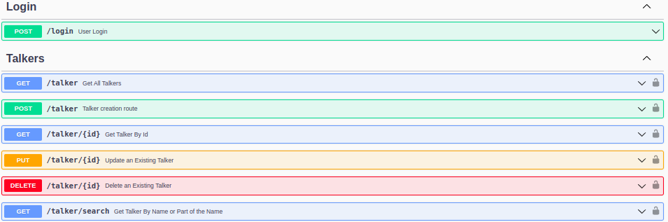
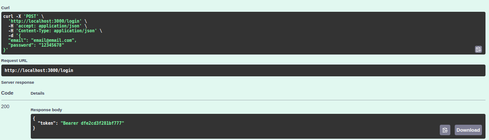
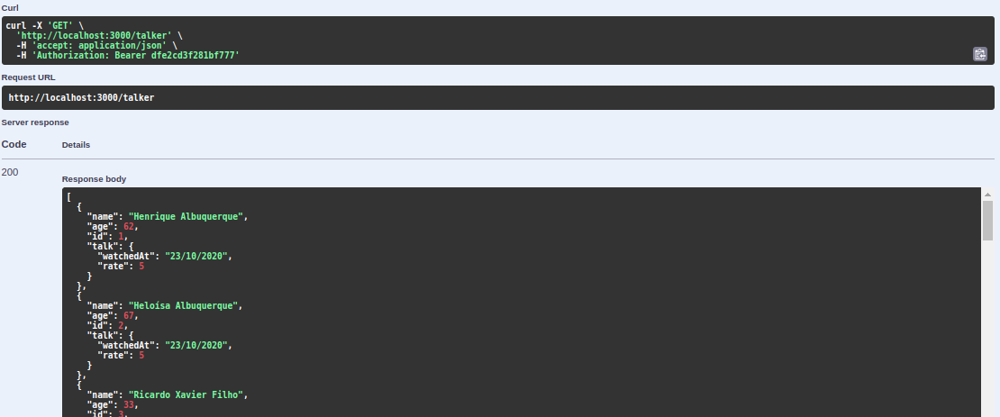
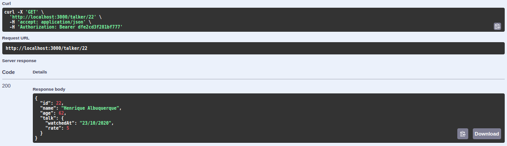
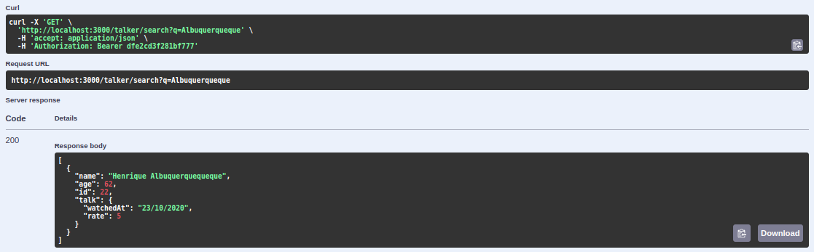
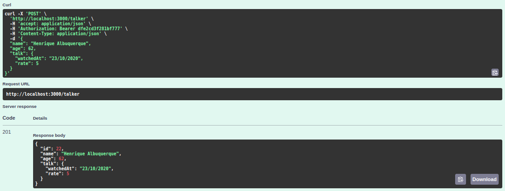
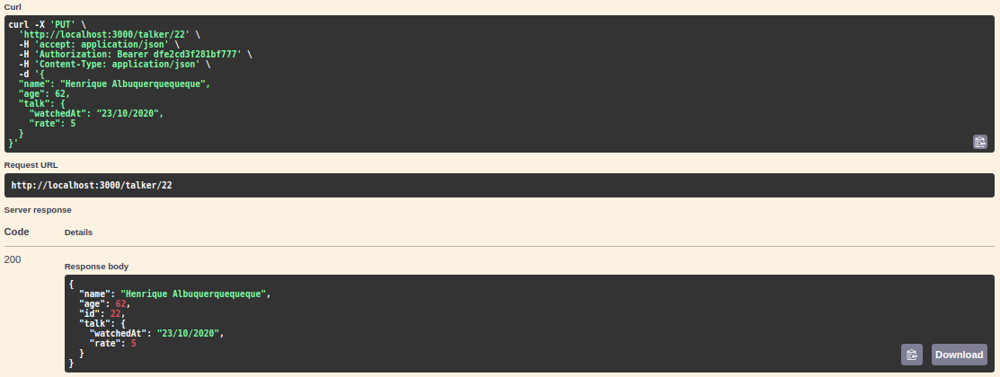
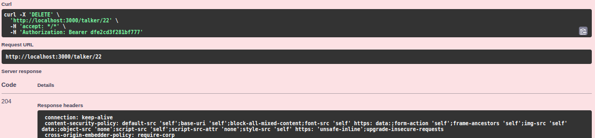

# Talker Manager API


🇧🇷 [Leia em português](./README.pt-br.md)

REST API to manage the speakers ("talkers") of an event: login, token-protected CRUD and search. Built during the backend module of Trybe's Full Stack Web Development course.

**🔗 Live API:** [talker-manager-one.vercel.app](https://talker-manager-one.vercel.app/) · **📘 Docs (Swagger):** [/api-docs](https://talker-manager-one.vercel.app/api-docs/)

> **Design note:** as an introduction to backend practices, this project deliberately has no relational database. Data is persisted in a JSON file through Node's `fs` module. A relational version with MySQL is in [store-manager](https://github.com/IgorMarinhoArgollo/store-manager).



## Features

- `POST /login` issues an access token
- Token-authenticated CRUD for talkers, plus search by name
- Swagger documentation at `/api-docs`
- Security basics: Helmet, rate limiting and centralized error handling
- Docker and Docker Compose setup, ESLint and Husky

## Tech stack


Also: Helmet, express-rate-limit, express-rescue and the Node `fs` module.

## API

| Method | Route | Description | Auth |
|---|---|---|---|
| POST | `/login` | Returns an access token | No |
| GET | `/talker` | Lists all talkers | Token |
| GET | `/talker/search` | Searches talkers | Token |
| GET | `/talker/:id` | Gets a talker | Token |
| POST | `/talker` | Creates a talker | Token |
| PUT | `/talker/:id` | Updates a talker | Token |
| DELETE | `/talker/:id` | Deletes a talker | Token |

<details>
<summary>Request examples (screenshots)</summary>









</details>

## Running locally

```bash
git clone https://github.com/IgorMarinhoArgollo/talker-manager.git
cd talker-manager
```

Create a `.env` file in the project root:

```env
PORT=3000
```

**With Docker:**

```bash
docker-compose up
```

**With Node.js:**

```bash
npm install
npm run dev
```

Open the docs at <http://localhost:3000/api-docs>.

## Author

**Igor Marinho Argollo** · [LinkedIn](https://www.linkedin.com/in/igormarinhoargollo/) · [Portfolio](https://igor-marinho.netlify.app/)

## License

MIT
