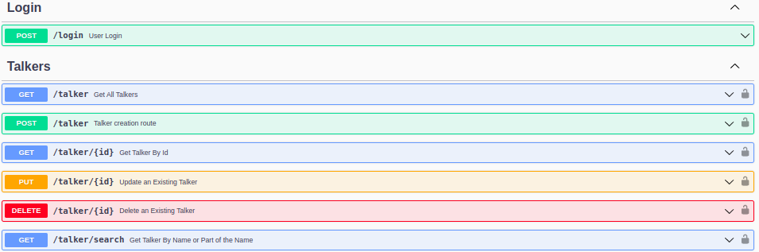
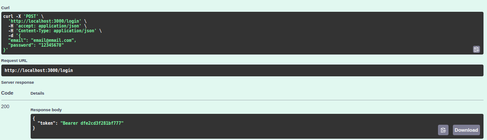
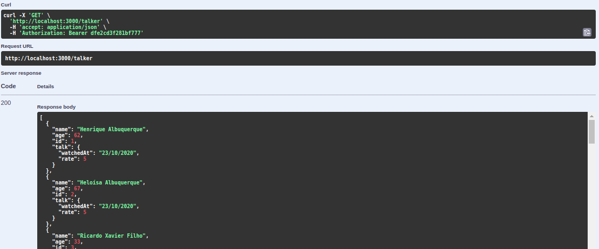
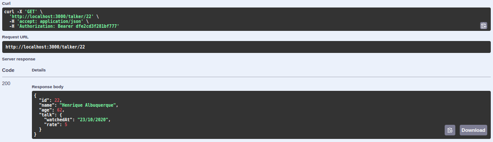
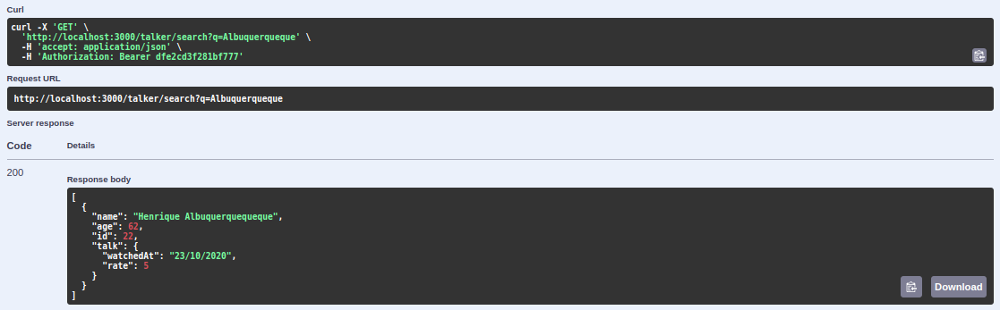
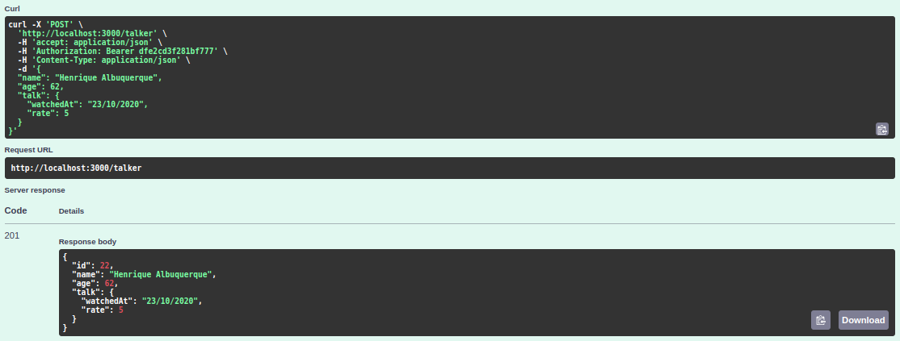
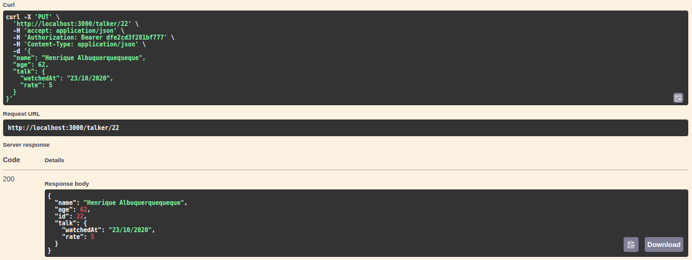
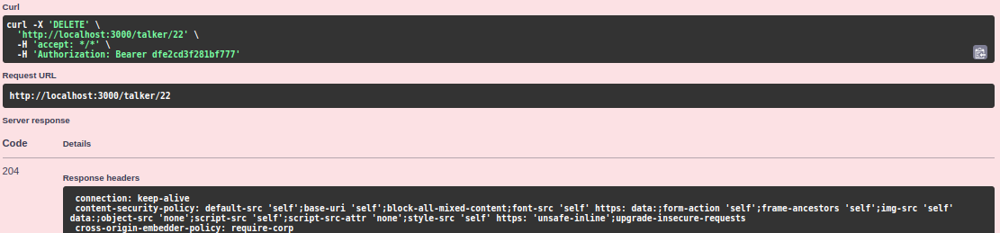

# Talker Manager API


🇺🇸 [Read in English](./README.md)

API REST para gerenciar os palestrantes ("talkers") de um evento: login, CRUD protegido por token e busca. Foi desenvolvida no módulo de backend do curso de Desenvolvimento Web Full Stack da Trybe.

**🔗 API no ar:** [talker-manager-one.vercel.app](https://talker-manager-one.vercel.app/) · **📘 Documentação (Swagger):** [/api-docs](https://talker-manager-one.vercel.app/api-docs/)

> **Decisão de projeto:** por ser uma introdução às práticas de backend, este projeto não usa banco de dados relacional de propósito. Os dados ficam em um arquivo JSON, acessado pelo módulo `fs` do Node. Uma versão com banco relacional (MySQL) está no [store-manager](https://github.com/IgorMarinhoArgollo/store-manager).



## Funcionalidades

- `POST /login` gera um token de acesso
- CRUD de palestrantes autenticado por token, com busca por nome
- Documentação com Swagger em `/api-docs`
- Boas práticas de segurança: Helmet, rate limit e tratamento centralizado de erros
- Configuração com Docker e Docker Compose, ESLint e Husky

## Tecnologias


Também: Helmet, express-rate-limit, express-rescue e o módulo `fs` do Node.

## API

| Método | Rota | Descrição | Autenticação |
|---|---|---|---|
| POST | `/login` | Retorna um token de acesso | Não |
| GET | `/talker` | Lista todos os palestrantes | Token |
| GET | `/talker/search` | Busca palestrantes | Token |
| GET | `/talker/:id` | Busca um palestrante | Token |
| POST | `/talker` | Cria um palestrante | Token |
| PUT | `/talker/:id` | Atualiza um palestrante | Token |
| DELETE | `/talker/:id` | Remove um palestrante | Token |

<details>
<summary>Exemplos de requisições (capturas de tela)</summary>









</details>

## Como rodar

```bash
git clone https://github.com/IgorMarinhoArgollo/talker-manager.git
cd talker-manager
```

Crie um arquivo `.env` na raiz do projeto:

```env
PORT=3000
```

**Com Docker:**

```bash
docker-compose up
```

**Com Node.js:**

```bash
npm install
npm run dev
```

Abra a documentação em <http://localhost:3000/api-docs>.

## Autor

**Igor Marinho Argollo** · [LinkedIn](https://www.linkedin.com/in/igormarinhoargollo/) · [Portfólio](https://igor-marinho.netlify.app/)

## Licença

MIT
